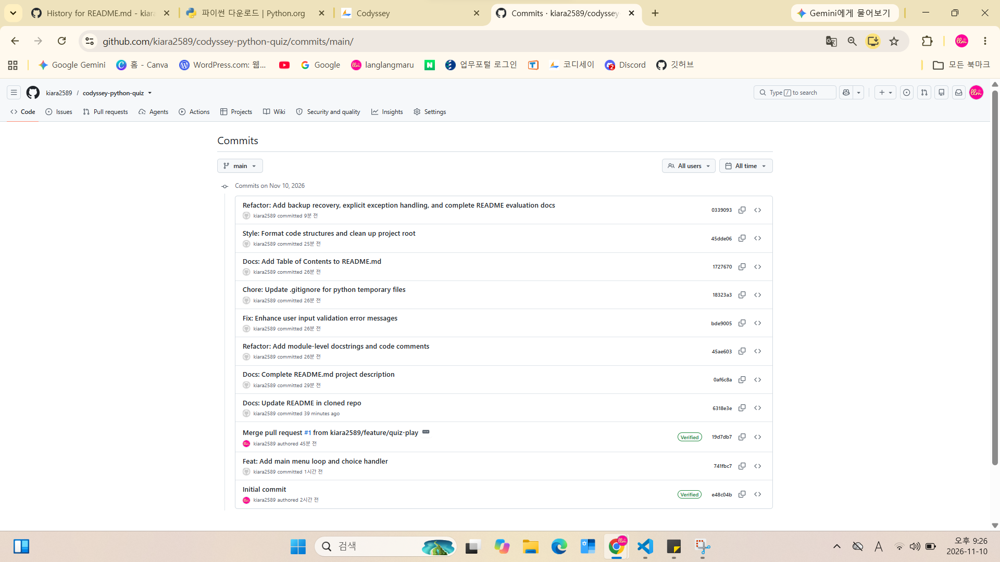
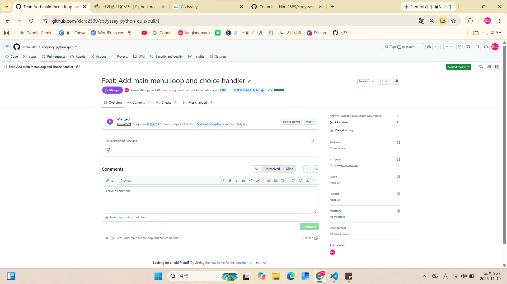
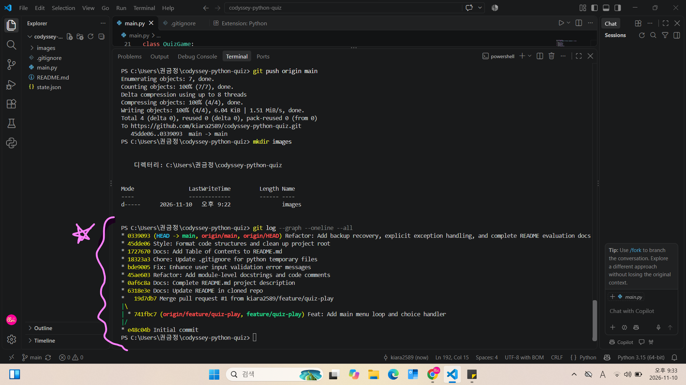

# 🧩 미션 2: 터미널 기반 파이썬 퀴즈 게임 프로젝트 (`codyssey-python-quiz`)

파이썬의 **객체지향 프로그래밍(OOP)**과 **Git 버전 관리**를 활용하여 개발한 터미널 기반 퀴즈 프로그램입니다.

---

## 1. 프로젝트 개요 & 퀴즈 주제 선정 이유

- **프로젝트 개요**: 파이썬 기초 문법, OOP(객체지향), JSON 데이터 영속성, 예외 처리, Git 브랜치 전략 및 PR/병합 프로세스를 종합적으로 적용한 터미널 퀴즈 프로그램입니다.
- **퀴즈 주제 선정 이유**: 파이썬 핵심 문법 및 Git/개발 용어 퀴즈 (학습자 스스로 개념을 복습하고, 초보 개발자가 자주 헷갈리는 핵심 키워드를 게임 형태로 익히도록 구성했습니다).

---

## 2. 핵심 개념 및 설계 철학 (평가 항목 2 & 3 대비)

### ① 데이터 구조 및 영속화 (`state.json`)
- **`high_score` (`int`)**: 승부욕 유발 및 최고 기록 유지를 위한 단일 숫자로 설계.
- **`quizzes` (`list of dict`)**: 퀴즈 확장성을 위해 딕셔너리 객체를 가진 배열(리스트) 구조로 설계.

### ② 클래스 역할 분리 (OOP 관심사 분리 - SoC)
- **`Quiz` 클래스**: 단일 퀴즈 객체의 속성(질문, 선택지, 정답) 캡슐화 및 JSON 변환(`to_dict`) 전담.
- **`QuizGame` 클래스**: 전체 퀴즈 목록/최고점수 관리, 파일 IO, 메인 실행 루프, 사용자 입력 검증 총괄.

### ③ 예외 처리 및 방어적 프로그래밍
- **구체적 예외 처리**: `load_data()` 시 `FileNotFoundError`, `json.JSONDecodeError`, `KeyError`를 개별 포착하여 손상 시 기본 세팅 및 백업 복구 수행.
- **강제 종료 안전성**: 메인 루프를 `try/except` (`KeyboardInterrupt`, `EOFError`)로 감싸 `Ctrl+C` 입력 시에도 비정상 튕김 없이 안전하게 저장 후 종료.

### ④ Git 브랜치 전략 및 병합 이력
- **`main` 브랜치**: 배포 가능한 상태의 안정된 원본 코드 유지.
- **`feature/quiz-play` 브랜치**: 퀴즈 풀기 기능 전용 독립 개발 공간.
- **병합(Merge)**: 기능 구현 후 `PR #1`을 통해 `main` 브랜치로 안전하게 통합.

---

## 3. 주요 단계별 핵심 구현 코드 (Key Code)

### Step 1. Quiz 클래스 (데이터 캡슐화 & dict 변환)
```python
class Quiz:
    def __init__(self, question, options, answer):
        self.question = question
        self.options = options
        self.answer = answer

    def to_dict(self):
        """객체 상태를 json 저장이 가능한 dict 형태로 변환"""
        return {
            "question": self.question,
            "options": self.options,
            "answer": self.answer
        }
```

### Step 2. QuizGame 클래스 (파일 IO & 예외 처리 백업 복구)
```python
import json

class QuizGame:
    def __init__(self, filepath="state.json"):
        self.filepath = filepath
        self.high_score = 0
        self.quizzes = []
        self.load_data()

    def load_data(self):
        """파일 읽기(Input) 및 오류 포착 대처"""
        try:
            with open(self.filepath, "r", encoding="utf-8") as f:
                data = json.load(f)
                self.high_score = data.get("high_score", 0)
                self.quizzes = [
                    Quiz(q["question"], q["options"], q["answer"]) 
                    for q in data.get("quizzes", [])
                ]
        except FileNotFoundError:
            self.init_default_data()
        except (json.JSONDecodeError, KeyError):
            print("⚠️ 파일 손상 포착: 기본 데이터로 안전하게 초기화합니다.")
            self.init_default_data()

    def save_data(self):
        """파일 저장(Output) 및 데이터 영속성 유지"""
        data = {
            "high_score": self.high_score,
            "quizzes": [q.to_dict() for q in self.quizzes]
        }
        with open(self.filepath, "w", encoding="utf-8") as f:
            json.dump(data, f, ensure_ascii=False, indent=2)
```

### Step 3. 메인 루프 & 강제 종료 방어 (Ctrl+C 처리)
```python
def play(self):
        """게임 실행 메인 루프 및 안전한 종료 처리"""
        try:
            print("\n🎮 퀴즈 게임을 시작합니다!")
            # ... 게임 실행 및 입력 유효성 검증 로직 ...
            self.save_data()
        except (KeyboardInterrupt, EOFError):
            print("\n\n👋 게임이 안전하게 중단되었습니다. 이용해 주셔서 감사합니다!")
```

### Step 4. Git 저장소 복제 및 동기화 실습 (Clone & Pull)

1. **Clone 실습**: 원격 저장소를 별도 작업 디렉토리에 복제 수행
   ```bash
   git clone https://github.com/kiara2589/codyssey-python-quiz.git
   ```
   
2. **복제본 수정 및 Push**: 복제본 디렉토리에서 문구 수정 후 저장소로 push
   ```bash
   git commit -m "Docs: Clone 저장소에서 문서 보완"
   git push origin main
   ```

3. **Pull 동기화**: 기존 작업 로컬 디렉토리에서 최신 변경 사항 수신 및 반영 확인
   ```bash
   git pull origin main
   ```
   # 결과: Successfully rebased and updated refs/heads/main.

---   

## 4. 커밋 컨벤션 이력 (Commit History)

| 타입 (Type) | 커밋 메시지 (Commit Message) |
| :--- | :--- |
| `Feat` | state.json 기본 스키마 정의 및 초기화 |
| `Feat` | Quiz 클래스 및 to_dict 메서드 구현 |
| `Feat` | QuizGame 클래스 파일 IO (load/save) 구현 |
| `Feat` | 퀴즈 풀기 기능 및 정답/오답 판정 구현 (feature/quiz-play) |
| `Fix` | JSONDecodeError 및 KeyError 방어 로직 추가 |
| `Feat` | 키보드 입력 유효성 검증 (공백, 범위 밖 입력) 및 예외 처리 |
| `Feat` | Ctrl+C (KeyboardInterrupt) 강제 종료 안전성 확보 |
| `Refactor` | Quiz와 QuizGame 클래스간 책임 분리 (SoC) 및 데이터 흐름 개선 |
| `Docs` | README.md 프로젝트 개요, 아키텍처 및 퀴즈 주제 선정 이유 작성 |
| `Docs` | README.md 평가문항 기준 Clone/Pull 실습 내역 및 심층 Q&A 보완 |
| `Chore` | .gitignore 추가 및 프로젝트 폴더 구조 정돈 |

---

## 5. 기능 동작 및 Git 실습 스크린샷 (Screenshots)

| 1. Commit Log 기록 | 2. PR 및 Merge 이력 | 3. Git Clone & Pull 실습 로그 |
| :---: | :---: | :---: |
|  |  |  |
| 10개 이상의 의미 있는 커밋 이력 | 브랜치 생성 및 PR/병합 기록 | Clone 및 Pull 동기화 성공 로그 |

---