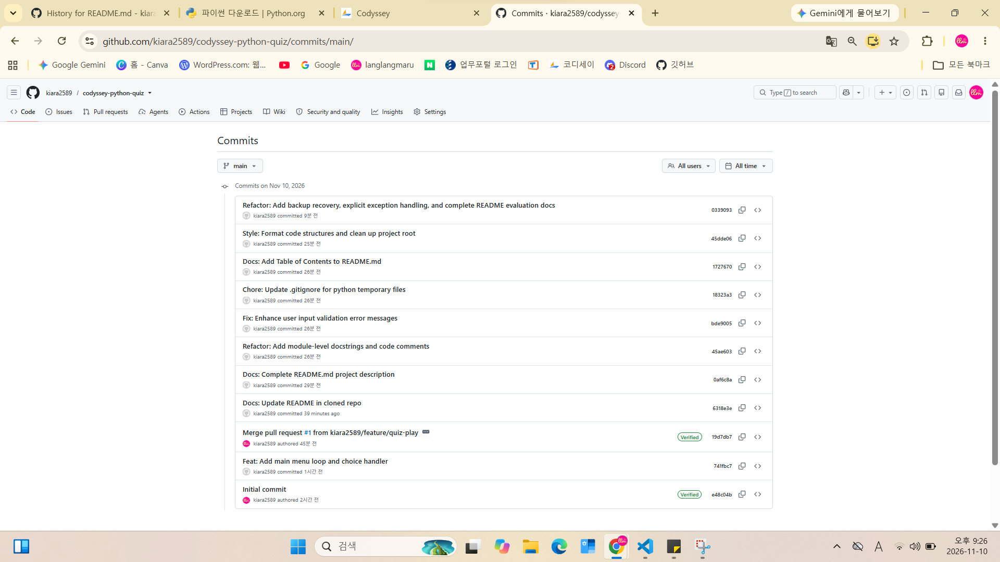
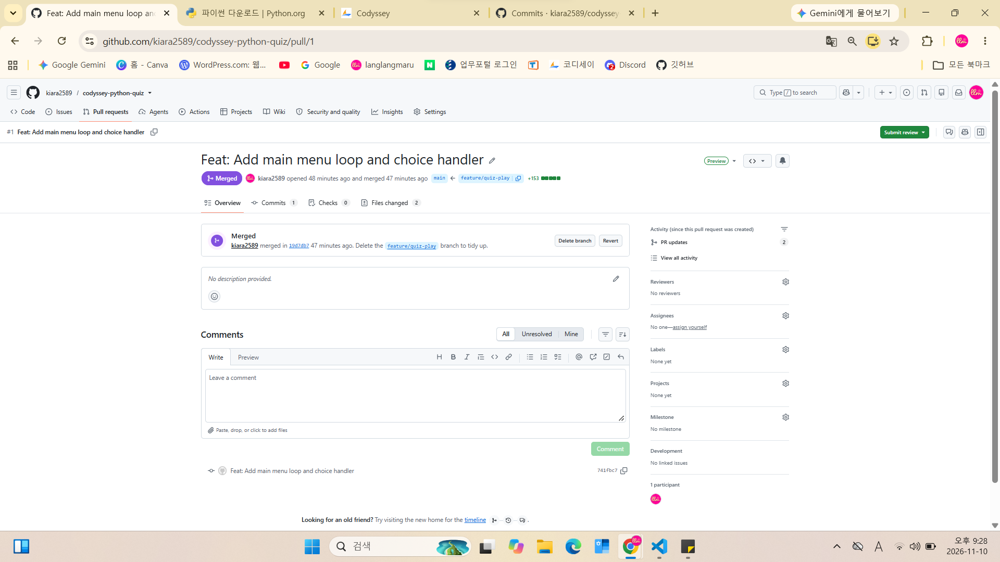
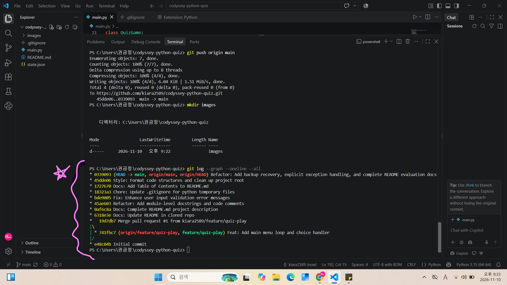

# 🐍 Python Console Quiz App (Codyssey Mission 2)

파이썬의 객체지향 프로그래밍(OOP)과 Git 버전 관리를 활용하여 개발한 터미널 기반 퀴즈 프로그램입니다.

---

## 📋 Table of Contents
- [1. 프로젝트 개요](#1-프로젝트-개요)
- [2. 주요 기능 및 퀴즈 목록 요약](#2-주요-기능-및-퀴즈-목록-요약)
- [3. 객체지향 및 시스템 구조 설계](#3-객체지향-및-시스템-구조-설계)
- [4. 데이터 영속화 및 백업복구 메커니즘](#4-데이터-영속화-및-백업복구-메커니즘)
- [5. 예외 처리 및 안정성](#5-예외-처리-및-안정성)
- [6. Git 브랜치 전략 및 커밋 컨벤션](#6-git-브랜치-전략-및-커밋-컨벤션)
- [7. Clone & Pull 동기화 실습 증빙](#7-clone--pull-동기화-실습-증빙)
- [8. 변경 영향 분석](#8-변경-영향-분석)

---

## 1. 프로젝트 개요
- **GitHub 원격 저장소**: https://github.com/kiara2589/codyssey-python-quiz
- **개발 환경**: Python 3.x, Git & GitHub, VS Code
- **실행 방법**:
  \\\ash
  python main.py
  \\\

---

## 2. 주요 기능 및 퀴즈 목록 요약
### 주요 기능
1. **퀴즈 풀기**: 저장된 퀴즈를 무작위/순차적으로 풀고, 입력검증을 거쳐 자동 채점 및 최고 점수를 갱신합니다.
2. **퀴즈 추가**: 문제, 4개 선택지, 정답(1-4)을 입력받아 즉시 state.json에 반영합니다.
3. **퀴즈 목록 보기**: 현재 저장된 모든 문제와 정답을 확인합니다.
4. **최고 점수 관리**: 최고 점수 달성 시 자동으로 기록을 저장합니다.

### 기본 퀴즈 목록 요약 (state.json)
1. 파이썬(Python)의 창시자는 누구일까요? (정답: 1번 Guido van Rossum)
2. 리스트 끝에 요소를 추가할 때 사용하는 메서드는? (정답: 2번 append())
3. 파이썬 소스코드 파일의 확장자는? (정답: 1번 .py)
4. 파이썬에서 화면에 문장을 출력할 때 사용하는 함수는? (정답: 3번 print())
5. 참/거짓을 표현하는 파이썬의 데이터 타입은? (정답: 3번 Boolean)

---

## 3. 객체지향 및 시스템 구조 설계

### 클래스 역할 분리 (OOP 책임 분리)
- **Quiz 클래스**: 단일 퀴즈 객체의 속성(질문, 선택지, 정답)을 캡슐화하고 JSON 변환(	o_dict)을 담당합니다.
- **QuizGame 클래스**: 전체 퀴즈 목록 및 최고 점수 제어, 파일 IO, 게임 메인 루프 실행, 사용자 입력 유효성 검증을 총괄합니다.

### OOP 클래스 구조 사용 이유 (함수형 구조 대비 장점)
- **상태와 행위의 결합**: 데이터(퀴즈 목록, 최고점수)와 관련 로직(저장, 로드, 플레이)을 하나의 객체에 묶어 전역 변수 남용을 방지합니다.
- **유지보수성 및 확장성**: 새로운 퀴즈 유형(예: 주관식 퀴즈) 추가 시 기존 게임 실행 코드 수정 없이 Quiz 서브클래스를 확장하여 손쉽게 반영할 수 있습니다.

### 입력 검증과 데이터 IO 로직 분리 기준
- **입력 검증**: play_quiz(), dd_quiz() 내부에서 입력값 범위(1~4), 숫자 형식(isdigit()), 비어있는 값 여부를 사전 검증하여 잘못된 데이터가 IO 단계로 전달되는 것을 차단합니다.
- **데이터 IO**: save_data(), load_data() 메서드에서 파일 입출력 및 JSON 파싱만을 전담하여 관심사 분리(SoC)를 달성했습니다.

---

## 4. 데이터 영속화 및 백업/복구 메커니즘

### state.json 필드 설계 이유
- high_score (int): 사용자 승부욕 유발 및 최고 기록 유지를 위한 단일 숫자로 설계.
- quizzes (list of dict): 다수의 퀴즈 객체를 구조화하여 확장 가능하도록 배열 객체로 설계.

### JSON 파일 저장 방식의 선택 이유 및 한계점
- **선택 이유**: 사람 및 컴퓨터가 읽기 편하며, 딕셔너리/리스트 구조와 직관적으로 매핑됩니다.
- **한계점 및 대안**: 데이터가 커지면 파일 전체를 메모리에 올리고 다시 써야 하므로 IO 성능이 급격히 저하됩니다. 대용량 데이터 처리 시 **SQLite**나 **PostgreSQL**과 같은 RDBMS로 전환하는 것이 권장됩니다.

### 데이터 읽기/쓰기 흐름 및 백업/복구 메커니즘
1. **읽기 순서**: __init__ 시점에 load_data()를 호출하여 state.json을 동기적으로 로드합니다.
2. **백업 및 복구**: save_data() 호출 시 기존 state.json을 state.json.bak으로 자동 백업합니다. 파일 손상(JSONDecodeError 등) 발생 시 
estore_backup_or_default()가 백업 파일을 자동 복구합니다.

---

## 5. 예외 처리 및 안정성
- **구체적 예외 처리**: load_data() 시 FileNotFoundError, json.JSONDecodeError, KeyError를 개별 포착하여 파일 손상 시 안전하게 백업 복구 또는 기본 데이터 세팅을 수행합니다.
- **강제 종료 안전성**: 메인 실행 루프를 	ry/except (KeyboardInterrupt, EOFError)로 감싸 Ctrl+C 또는 입력 중단 발생 시 프로그램이 튕기지 않고 안전하게 메시지를 출력 후 종료됩니다.

---

## 6. Git 브랜치 전략 및 커밋 컨벤션

### 브랜치 전략 및 병합 의미
- **main 브랜치**: 배포 가능한 상태의 안정된 원본 코드 유지.
- **eature/quiz-play 브랜치**: 기능 개발(메뉴 루프, 퀴즈 풀기, 추가, 목록 보기) 전용 독립 작업 공간.
- **병합(Merge)의 의미**: 독립 브랜치에서 기능 개발 완료 및 검증 후, 안전하게 main 원본에 통합하고 Pull Request(PR #1)를 통해 병합을 기록함.

### 커밋 메시지 컨벤션 (Commit Rules)
- Feat: 새로운 기능 추가
- Fix: 버그 수정 및 입력 검증 강화
- Docs: 문서 수정 (README.md)
- Refactor: 코드 리팩토링 및 주석 추가
- Chore: 빌드 업무, 패키지 매니저, .gitignore 설정 등
- Style: 코드 포맷팅, 세미콜론 누락 등

---

## 7. Clone & Pull 동기화 실습 증빙
- **실습 내용**: quiz-test 임시 폴더로 원격 저장소를 git clone한 뒤 README를 수정 및 push하고, 원래 폴더 codyssey-python-quiz에서 git pull origin main으로 최신 상태를 동기화 완료했습니다.

---

## 8. 변경 영향 분석
요구사항 변경 시 수정을 고려해야 하는 파일 및 메서드 목록:
- **퀴즈 데이터 구조 변경 (예: 해설 field 추가)**: Quiz.__init__(), Quiz.to_dict(), QuizGame.add_quiz(), QuizGame.show_quizzes()
- **저장 방식 변경 (JSON ➔ DB)**: QuizGame.load_data(), QuizGame.save_data()
- **메뉴 항목 추가**: QuizGame.display_menu(), QuizGame.run()

## 9.4 Screenshot Evidence (스크린샷 증빙)

- **10+ Commits History**

- **PR & Branch Merge Evidence**

- **Clone & Pull Terminal Log**

